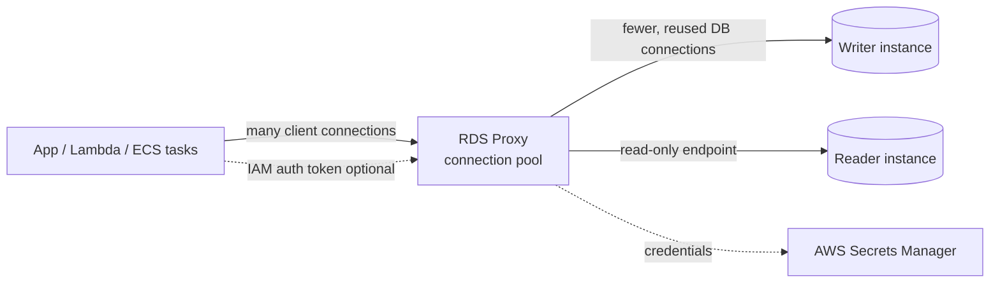

# Database Connections and Proxies on AWS

---

## 1. Why database connections are a scaling problem

Every connection to a relational database costs the server memory and CPU. Opening one also involves work: a network handshake, TLS negotiation, authentication, and capability negotiation. A database engine has a hard ceiling on concurrent connections (for example, the `max_connections` parameter in MySQL/PostgreSQL), and that ceiling is usually derived from instance size.

Modern architectures make this worse:

- **Serverless functions (AWS Lambda)** can scale to hundreds or thousands of concurrent executions, each opening its own connection.
- **Auto-scaling fleets** (EC2, ECS, EKS) add instances during traffic surges, and every instance brings its own client-side pool.
- **Short-lived processes** (cron jobs, containers that restart) repeatedly open and close connections.

The typical symptoms are "too many connections" errors, rising latency, high CPU spent on connection management, and slow recovery after a failover because thousands of clients reconnect at once.

Two remedies exist:

1. **Client-side pooling** (e.g., HikariCP, SQLAlchemy pool, pgbouncer-style libraries) — each app instance keeps its own small pool.
2. **A managed proxy** that sits between all clients and the database and pools connections centrally. On AWS, this is **Amazon RDS Proxy**.

---

## 2. What is Amazon RDS Proxy?

RDS Proxy is a fully managed, highly available database proxy for Amazon RDS and Amazon Aurora. It lets applications pool and share database connections so they scale better. AWS describes its compute resources as serverless: they scale automatically with the workload, so there is nothing to patch or size.

Core benefits documented by AWS:

| Benefit | What it means |
|---|---|
| **Connection pooling** | Maintains a pool of established database connections and reuses them, cutting connection setup overhead. |
| **Protection from surges** | Queues or throttles connections that cannot be served immediately instead of letting the database be overwhelmed. |
| **Faster, more graceful failover** | Preserves client connections to the proxy during a database failover, reducing the visible impact on applications. |
| **Centralized security** | Enforces IAM authentication toward the proxy and stores database credentials in AWS Secrets Manager. |
| **Lower database overhead** | Handles TLS and authentication work on behalf of the database. |

RDS Proxy is not a cache and not a query router that rewrites SQL. It is a connection-management layer that adjusts its behavior based on the SQL operations it sees and the results returned.

---

## 3. Key concepts and terminology

### 3.1 Connection pool
The set of connections that the proxy keeps open and available to the database. Pooling is done separately for the writer and the reader instances associated with the proxy.

### 3.2 Multiplexing (connection reuse)
By default, RDS Proxy can reuse an underlying connection after every transaction. All operations of one transaction run on a single database connection; the next transaction from the same client session may use a different one. This transaction-level reuse is called **multiplexing**.

When the proxy temporarily takes a connection from the pool to serve a transaction, that is called **borrowing**.

The result: many client connections can be served by far fewer database connections, which also lowers the chance of "too many connections" errors.

### 3.3 Pinning
Sometimes the proxy cannot be sure it is safe to hand a connection to another session, because session state may have been changed. In that case it keeps the client session on the same database connection until the session ends. This fallback is called **pinning**.

A pinned connection is unavailable to other clients, so pinning erodes the benefit of pooling. Examples that AWS documents or that are commonly associated with pinning include:

- Statements whose text is larger than 16 KB.
- Certain session-level changes (for example, some `SET` commands, temporary tables, and similar state-changing operations, depending on the engine).
- Multiple active result sets (MARS) on SQL Server, where initialization queries are also not run.

Because the exact list differs by engine and version, AWS directs readers to the page **"Avoiding pinning an RDS Proxy"** for the current rules. Some statements and functions can change connection state without causing pinning, so always check the latest documentation rather than assuming.

### 3.4 Engine family
An engine family is a set of database engines that speak the same wire protocol. You choose the engine family when creating each proxy (for example, MySQL-compatible, PostgreSQL-compatible, or SQL Server).

### 3.5 Proxy endpoints
A proxy has a **default endpoint** that applications use instead of connecting directly to the instance or cluster endpoint. For Aurora and Multi-AZ DB clusters you can also create **additional read/write and read-only endpoints**. Applications may still connect directly to the cluster endpoint or the reader endpoint when they need to bypass pooling.

---

## 4. Architecture at a glance



Flow in words:

1. The application connects to the **proxy endpoint** (not the database endpoint).
2. The proxy authenticates the client (password or IAM) and terminates TLS if required.
3. When a query or transaction arrives, the proxy borrows a back-end connection, runs the work, and returns the connection to the pool when it is safe to do so.
4. If the pool has no free connection and the limit is reached, the request waits (up to a timeout) or is rejected.

---

## 5. Security model

### 5.1 TLS/SSL
Clients can connect to RDS Proxy using TLS. By default client programs establish an encrypted connection, and the proxy supports all client SSL modes. Key points:

- RDS Proxy uses certificates issued through **AWS Certificate Manager (ACM)**, so you generally do not need to download RDS-specific certificates for proxy connections.
- For `VERIFY_CA` or `VERIFY_IDENTITY` modes, provide a CA bundle in `.pem` format, built from the Amazon Trust Services root CAs.
- For PostgreSQL, specify `sslmode=require` in the connection string.
- To force TLS for every connection between clients and the proxy, enable **Require Transport Layer Security** when you create or modify the proxy.

### 5.2 Authentication options
- **Client → proxy:** database username/password, or **IAM authentication** (the app presents a short-lived token instead of a password).
- **Proxy → database:** credentials stored in **AWS Secrets Manager**, or IAM database authentication.

This split lets you enforce stronger authentication on the application side without migrating the database itself, and it keeps passwords out of application code.

### 5.3 Network placement
A proxy runs inside your VPC and is reachable only from within it (or via connected networks). Use security groups to allow the application to reach the proxy, and the proxy to reach the database. If services such as AWS Lambda connect to RDS databases, switch their connection settings to the **proxy endpoint**.

---

## 6. Configuring the connection pool

The most important tuning knobs live in the proxy's target group configuration.

### 6.1 MaxConnectionsPercent
The maximum share of the database's connection limit that the proxy may use. Because it is a percentage, the pool size automatically follows the database configuration: when you resize an instance, the implicit limit changes and you do not need to reconfigure the proxy.

Guidance from AWS:

- The proxy opens back-end connections on demand, so the actual number at any moment can be lower than the maximum.
- Although the value can be as low as 1, AWS recommends higher minimums for small instances (for example, 100 for `db.t3.small`, 55 for `db.t3.medium`, 35 for `db.t3.large`, and 20 for `db.r3.large` and above).
- Leave headroom: if you expect the proxy to need 50% of the database limit, set at least about 1.3 × 50% = 65%. A related AWS troubleshooting tip is to keep the setting roughly 30% above the highest recently observed usage.
- You do not need multiple proxies per database for redundancy.

### 6.2 MaxIdleConnectionsPercent
Caps how many **idle** back-end connections the proxy keeps in the pool, again as a percentage of the database limit. It does not force the proxy to hold that many; if client activity is low, the real count can be lower.

Trade-offs:

- **Lower value:** fewer idle connections held open, but spikes can see longer borrow times because new connections must be opened on demand.
- **Higher value:** more connections ready, so spikes see lower borrow latency, at the cost of more idle connections on the database.

Notes: pinned connections do not count as idle. A back-end connection is considered idle after five minutes of inactivity. Idle counts reported by database tools often differ from those reported by RDS Proxy metrics, because the proxy pings back-end connections occasionally.

### 6.3 ConnectionBorrowTimeout
How long a client waits for a connection from the pool when none is free. If the wait exceeds this timeout, the request fails. Raising it smooths short spikes at the cost of higher latency; lowering it fails fast.

### 6.4 IdleClientTimeout
How long a **client-to-proxy** connection may stay idle before the proxy closes it. Range: 1 minute to 8 hours; default 30 minutes. For correct enforcement the client connection must be truly idle: even a periodic `SELECT 1` or protocol ping resets the timer. Set it long enough to cover normal pauses inside a client session or transaction.

The proxy also enforces a **maximum connection lifetime of 24 hours**, regardless of activity.

### 6.5 Initialization query (optional)
You can specify a query that runs when the proxy opens a new back-end connection, for example to set session parameters. Be aware of engine-specific caveats (such as MARS on SQL Server).

### 6.6 Example: CLI configuration

```bash
aws rds modify-db-proxy-target-group \
  --target-group-name default \
  --db-proxy-name my-app-proxy \
  --connection-pool-config \
    MaxConnectionsPercent=90,MaxIdleConnectionsPercent=50,ConnectionBorrowTimeout=120
```

### 6.7 Example: connecting from an application (PostgreSQL)

```python
import psycopg2

conn = psycopg2.connect(
    host="my-app-proxy.proxy-xxxx.us-east-1.rds.amazonaws.com",  # proxy endpoint
    port=5432,
    dbname="myappdb",
    user="app_user",
    password=get_secret(),   # fetch from Secrets Manager, never hard-code
    sslmode="require",
)
```

---

## 7. Failover behavior

During a database failover (planned or unplanned), direct connections are dropped and clients must reconnect, often all at the same time. With RDS Proxy:

- Client connections to the proxy are preserved where possible.
- The proxy reconnects to the new writer by itself and routes traffic once it is available.
- In-flight transactions that were not committed may still fail and must be retried by the application.

Good practice: keep **retry logic with exponential backoff and jitter** in the application, and make transactions idempotent where possible. A proxy reduces failover impact; it does not make it invisible.

---

## 8. Using RDS Proxy with AWS Lambda

Lambda is the classic use case. Each concurrent execution environment can open its own connection, so a traffic burst may exhaust the database quickly.

Recommendations:

1. **Point Lambda to the proxy endpoint**, not the database endpoint.
2. **Create the connection outside the handler** so warm invocations reuse it.
3. Run the function **in the same VPC** (and subnets/security groups that can reach the proxy).
4. Prefer **IAM authentication** or Secrets Manager retrieval with caching, rather than embedding passwords.
5. Keep transactions short so multiplexing can return connections to the pool quickly.
6. Watch for pinning caused by session-level settings inside the function.

---

## 9. Monitoring and troubleshooting

RDS Proxy publishes metrics to Amazon CloudWatch (namespace `AWS/RDS`). Useful ones:

| Metric | Why it matters |
|---|---|
| `ClientConnections` | Connections from applications to the proxy. |
| `DatabaseConnections` | Connections from the proxy to the database. |
| `MaxDatabaseConnectionsAllowed` | Effective ceiling given your `MaxConnectionsPercent`. Compare with `DatabaseConnections`. |
| `DatabaseConnectionsBorrowLatency` | Time to obtain a connection from the pool. Sustained high values signal an undersized or pinned pool. |
| `AvailabilityPercentage` | Whether the proxy can reach its target; should be close to 100%. |

Enable **enhanced/debug logging** only while troubleshooting, because it adds overhead. Logs are written to CloudWatch Logs under `/aws/rds/proxy/<name>`, where CloudWatch Logs Insights queries can help find anomalies.

### Common log messages and what to do

| Symptom (paraphrased) | Likely cause | Action |
|---|---|---|
| Connection closed because the pool reached its maximum and a connection with different properties was needed | Pool limit hit | Compare `DatabaseConnections` with `MaxDatabaseConnectionsAllowed`; throttle traffic or raise `MaxConnectionsPercent` (leave ~30% headroom). |
| Connection closed because there were too many idle connections | Idle limit exceeded | If `ClientConnections` stays below `DatabaseConnections`, idle back-end connections exist; adjust `MaxIdleConnectionsPercent`. |
| Client connection closed because idle timeout exceeded | Client silent too long | Increase `IdleClientTimeout` or reconnect on demand. |
| High borrow latency with modest client count | Pool exhausted or pinned sessions | Check limits, review code for pinning patterns, verify target availability. |

You can also create CloudWatch alarms on `DatabaseConnections` approaching the allowed maximum.

---

## 10. Quotas and limitations (highlights)

Always verify the current list, since support varies by engine version and Region.

- Default limit of **20 proxies per AWS account** per Region (increase available via Service Quotas).
- **Not supported:** RDS Custom for SQL Server; self-managed MariaDB on EC2; Aurora Serverless v1 (Aurora Serverless v2 is supported).
- Some MariaDB specifics: not supported for DB instances whose `read_only` parameter is 1; certain auth plugins (such as `auth_ed25519`) and the `caching_sha2_password` client auth type are not supported.
- Statements larger than 16 KB pin the session.
- Diagnostics commands such as `GET DIAGNOSTICS` may return inaccurate results when connections are multiplexed.
- Some Regions have Availability Zone restrictions when creating a proxy.
- Engine versions and Regions supported differ; consult the *Supported Regions and DB engines for Amazon RDS Proxy* page.

---

## 11. Best practices checklist

**Design**
- [ ] Use the proxy endpoint for all application traffic, including Lambda.
- [ ] Use separate read-only endpoints for reporting or read-heavy workloads on Aurora.
- [ ] Keep a modest client-side pool too, so each app instance does not open unnecessary connections.

**Pool tuning**
- [ ] Set `MaxConnectionsPercent` with about 30% headroom above peak observed usage.
- [ ] Balance `MaxIdleConnectionsPercent` between spike readiness and idle resource use.
- [ ] Choose `ConnectionBorrowTimeout` according to how long your users can wait.
- [ ] Align `IdleClientTimeout` with the longest legitimate pause in your application.

**Avoiding pinning**
- [ ] Avoid session-level `SET` statements and temporary tables where possible.
- [ ] Keep statements small and transactions short.
- [ ] Review the "Avoiding pinning" documentation for your engine.

**Security**
- [ ] Require TLS.
- [ ] Prefer IAM authentication to the proxy; keep database secrets in Secrets Manager with rotation.
- [ ] Restrict security groups to only the required sources.

**Operations**
- [ ] Alarm on `DatabaseConnections`, `DatabaseConnectionsBorrowLatency`, and `AvailabilityPercentage`.
- [ ] Implement retries with backoff for failovers and transient errors.
- [ ] Turn off debug logging when not troubleshooting.

---

## 12. When a proxy may not be the right answer

- **Very low connection counts and long-lived sessions:** the benefit is small, and a client-side pool may suffice.
- **Workloads that pin heavily:** if almost every session changes state, multiplexing gains disappear; fix the application patterns first.
- **Unsupported engine/version combinations** (see limitations above).
- **Ultra-low-latency needs:** a proxy adds a network hop; measure the overhead for your workload.

---

## 13. Quick summary

- Database connections are expensive and limited; bursty and serverless workloads can exhaust them.
- **RDS Proxy** pools and multiplexes connections, absorbs surges, helps failover, and centralizes authentication.
- **Pinning** is the main thing that reduces its efficiency; learn what triggers it.
- Tune **MaxConnectionsPercent**, **MaxIdleConnectionsPercent**, **ConnectionBorrowTimeout**, and **IdleClientTimeout** using CloudWatch metrics.
- Pair the proxy with TLS, IAM/Secrets Manager, retries, and monitoring.

---

## References (AWS documentation)

- Amazon RDS Proxy — https://docs.aws.amazon.com/AmazonRDS/latest/UserGuide/rds-proxy.html
- RDS Proxy concepts and terminology — https://docs.aws.amazon.com/AmazonRDS/latest/UserGuide/rds-proxy.howitworks.html
- Aurora version of the same topic — https://docs.aws.amazon.com/AmazonRDS/latest/AuroraUserGuide/rds-proxy.howitworks.html
- RDS Proxy configuration guidelines — https://docs.aws.amazon.com/AmazonRDS/latest/UserGuide/rds-proxy-best-practices.configuration.html
- AWS re:Post knowledge center: RDS Proxy connection pooling — https://repost.aws/knowledge-center/rds-proxy-connection-pooling

*Note: Limits, defaults, and supported engines change over time. Confirm specifics in the current AWS documentation before production use.*
